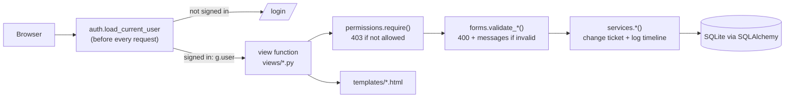
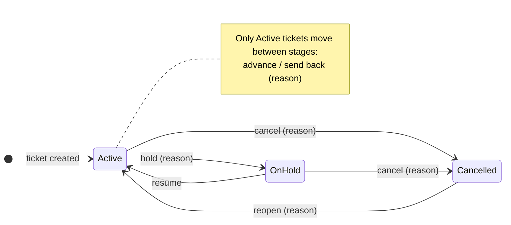
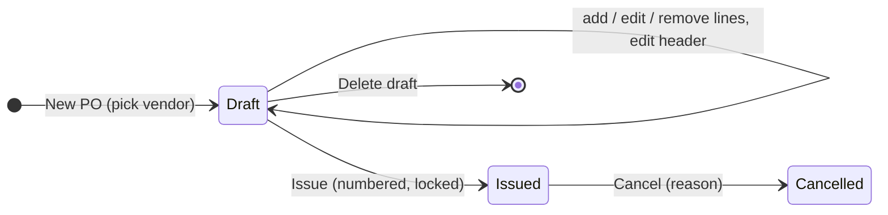
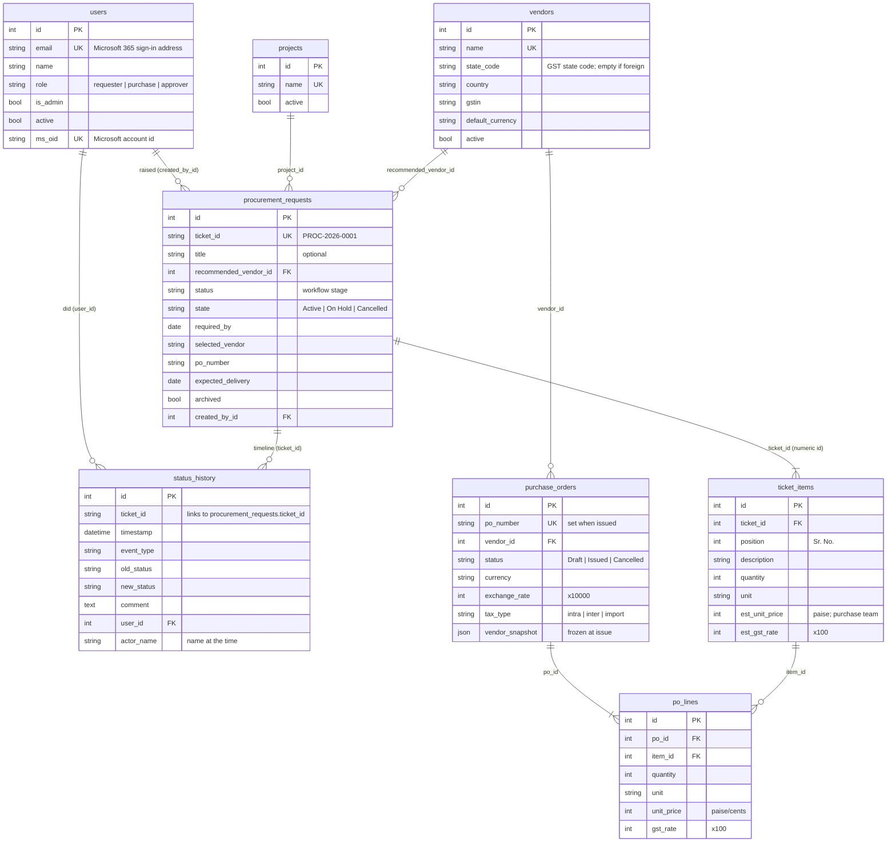

# ProcureTrack Developer Guide

For developers taking over or extending ProcureTrack. For installing and running
it on one PC, see the [README](../README.md); for putting it live on a server, see
[DEPLOYMENT.md](DEPLOYMENT.md).

**Contents**

1. [What the app does](#1-what-the-app-does)
2. [Get it running](#2-get-it-running)
3. [Project map](#3-project-map)
4. [How a request is handled](#4-how-a-request-is-handled)
5. [The ticket workflow](#5-the-ticket-workflow)
6. [Data model](#6-data-model)
7. [Roles and permissions](#7-roles-and-permissions)
8. [Sign-in](#8-sign-in)
9. [Database, migrations and backups](#9-database-migrations-and-backups)
10. [Conventions](#10-conventions)
11. [How to… (common changes)](#11-how-to-common-changes)
12. [Testing](#12-testing)
13. [Gotchas](#13-gotchas)

---

## 1. What the app does

ProcureTrack is ERIC Robotics' internal procurement hub. An engineer raises a
**ticket**, which is a purchase requisition: the vendor they recommend and one or more
items with quantities. The purchase team adds prices from the quotation and sends it for
**approval**. The approver approves or rejects it. After approval the purchase team
releases the PO and tracks payment and delivery until the ticket is closed. Every step
is recorded in the ticket's **activity timeline** with who did it and when.

It is used only inside the company. There are no customer-facing parts.

**Stack:** Python 3.12+, Flask 3, SQLAlchemy 2 + Alembic (via Flask-SQLAlchemy /
Flask-Migrate), Jinja2 templates with plain CSS, SQLite (PostgreSQL-ready), waitress
as the production server, MSAL for Microsoft 365 sign-in. There is no JavaScript
framework and no build step.

## 2. Get it running

```powershell
cd PT_V0_3
python -m venv .venv
.\.venv\Scripts\python -m pip install -r requirements-dev.txt

# a user to sign in as (the login page lists users while Microsoft 365 isn't configured)
.\.venv\Scripts\flask --app app add-user --email dev@example.com --name "Dev" --role purchase --admin

.\.venv\Scripts\flask --app app run --debug     # http://127.0.0.1:5000, auto-reload
.\.venv\Scripts\python -m pytest                # tests
.\.venv\Scripts\ruff format . ; .\.venv\Scripts\ruff check .   # formatting + lint
```

Settings come from environment variables or a `.env` file in the project folder
(`config.py` loads it; copy `.env.example`). **On the production PC, `.env` points at the real
data (`C:\ProcureTrack\data`).** To work with a throwaway database instead, override it in your
terminal first: `$env:PROCURETRACK_DATA_DIR="C:\temp\pt-dev"`. Real environment variables
take precedence over `.env`.

## 3. Project map

```
app.py                      Entry point. `python app.py` = production server (waitress)
procuretrack/               The application package
  __init__.py               create_app(): config, extensions, blueprints, error pages, template helpers
  config.py                 Settings read from environment variables; paths
  constants.py              Workflow stages, dropdown options, event types, field limits
  models.py                 Database tables (tickets and their items, timeline, users, vendors, POs)
  permissions.py            can(action, ticket): every "is this user allowed" rule
  forms.py                  Form validation: request.form -> (clean data, errors); GSTIN/PAN checks
  services.py               Ticket logic: create/advance/approve/hold/edit + timeline logging
  purchasing.py             PO logic: draft, add lines, issue (numbering, snapshots), cancel
  money.py                  Pure functions: GST per line, totals, ₹ formatting, amount in words
  database.py               Startup: copy legacy DB, back up, run migrations; backup helper
  commands.py               CLI: `flask backup`, `flask add-user`
  extensions.py             db, migrate, csrf objects
  views/                    Flask blueprints (URL routes)
    auth.py                 /login, /logout, Microsoft 365 callback, "login required" hook
    main.py                 / (dashboard), /reports
    tickets.py              /queue, /request, /ticket/<id>/..., /tracking, /archive
    pos.py                  /pos: list, new, draft editing, issue, cancel, /pos/<id>/print
    vendors.py              /vendors: directory, add/edit, vendor detail with its POs
    projects.py             /projects
    settings.py             /settings: company details on POs (admins only)
    users.py                /users (admins only)
templates/                  Jinja2 HTML. base.html = layout; _macros.html = shared pieces
static/                     style.css, logo, vendor/lucide (icons, served locally)
migrations/                 Alembic: env.py + versions/ (one file per schema change)
tests/                      pytest: conftest.py (fixtures), helpers.py, test_*.py
scripts/                    start.bat, backup.bat (for Windows Task Scheduler)
docs/                       This guide and the roadmap
.env                        Machine settings (data folder, secrets). NOT in git; template: .env.example
instance/                   Default data folder if PROCURETRACK_DATA_DIR isn't set. NOT in git
```

`templates/` and `static/` live at the project root rather than inside the package.
`create_app()` points Flask at them.

## 4. How a request is handled



A typical action, "advance a ticket" (`views/tickets.py: workflow_action`):

1. `get_ticket_or_404(ticket_id)`
2. `require("advance", ticket)`: at *Approval Pending* this means "is an approver"
3. `validate_comment(request.form, required=...)`
4. `services.advance(ticket, g.user, comment)` changes `status` and logs an event
5. `db.session.commit()`, then `flash(...)` and redirect to the ticket page

Templates call the same `can(...)` to decide which buttons to show, so the
UI and the server never disagree.

## 5. The ticket workflow

A ticket has two separate fields:

- **`status`**: the *stage*, one of `constants.PROCUREMENT_FLOW` (15 stages,
  *Requirement Raised* → … → *Closed*). It moves one step at a time: advance or send back.
- **`state`**: `Active`, `On Hold` or `Cancelled`. Holding or cancelling doesn't
  change the stage, so the ticket resumes where it stopped.

Separately, `archived` hides a ticket from the working lists (queue, dashboard)
without changing anything else.



**The approval gate.** `constants.APPROVAL_STAGE` is *Approval Pending*. Moving a
ticket **past** it is approving. Tickets estimated below ₹25,000 (including GST) require
the Team Lead role; tickets at ₹25,000 or more require the Approver role, assigned to Chirag.
When the approver sends it back, that's a rejection, and a reason is required.
Both are logged as `APPROVED` / `REJECTED` events. When an approver approves a
ticket they raised themselves, the timeline says "Self-approved"
(`ALLOW_SELF_APPROVAL` in `config.py`).

**Timeline events** (`StatusHistory.event_type`; labels in `constants.EVENT_LABELS`):
`STATUS_CHANGE`, `APPROVED`, `REJECTED`, `SENT_BACK`, `ON_HOLD`, `RESUMED`,
`CANCELLED`, `REOPENED`, `EDITED`, `TRACKING_UPDATE`, `ARCHIVED`, `RESTORED`,
`PO_ISSUED`, `PO_CANCELLED`, `MIGRATION_NOTE`. Edits store a readable list of what
changed, e.g. `Priority: High → Critical` or `Item BLDC Motor: quantity 10 → 12`.

### The requisition (before approval)

A ticket **is** ERIC's paper **Purchase Requisition Form**: one recommended vendor
(`ProcurementRequest.recommended_vendor_id`) and one or more **items** (`TicketItem`: Sr. No.
= `position`, description, quantity, unit). The title is optional; lists show
`ProcurementRequest.summary` (the title, or the first item + "N more").

Who fills in what (ERIC's process):

1. The **engineer** raises the ticket, chooses the vendor and lists the items
   (`ticket_form.html`; rows are posted as parallel lists `item_id` / `item_description` /
   `item_quantity` / `item_unit`, parsed by `forms._item_rows`). They can edit the vendor and
   items until it is sent for approval. A vendor that isn't in the list can be added right
   there ("+ Add a new vendor": fields `new_vendor_*`, validated by `validate_vendor_form`,
   saved by `services._add_new_vendor` and noted in the timeline).
2. The **purchase team** adds the estimated unit price and GST % per item from the quotation
   (the prices table on the ticket page → `POST /ticket/<id>/prices` → `services.update_prices`,
   logged as `REQUISITION`). They can also change the vendor or items until approval.
3. `services.advance` refuses to send a ticket for approval until `missing_for_approval` is
   empty: vendor chosen, every item priced. The approver sees the vendor and the estimated
   total (`ProcurementRequest.estimate`, a `money.Totals`).
4. Once approved, the vendor, items and prices are locked for everyone
   (`permissions.requisition_open`); general details (priority, dates…) stay editable by
   the purchase team. Sending the ticket back to *Approval Pending* reopens them.

Edits to items that are already on POs are refused by `services.check_item_changes`: an
item on a PO can't be removed, its quantity can't drop below what's on POs, and its unit
can't change.

The printed form (`/ticket/<id>/requisition/print`, `templates/requisition_print.html`)
reproduces the paper form with one row per item. "Last Purchase Date / Last PO Qty/Rate"
come from the latest issued PO line for an item with the same description
(`purchasing.last_purchase`), prefixed with the Sr. No. when there are several items. The
Requisitioner box shows the engineer who raised it; the Director box shows who approved
it. The Operations Manager box is left for a manual signature.

### Purchase orders

A ticket has one or more **items**. A **PO** goes to one vendor and has **lines; each line
is for one ticket item**. So one PO can combine items from several tickets, and one item
can be split across POs to different vendors (6 units from A, 4 from B).

From a PO draft the purchase team either adds **all items of a ticket** at once
(`purchasing.add_ticket`: remaining quantities at the approved prices; INR POs only, since
estimates are in rupees) or **one item** at a time with its own quantity and price.



- An item can go on a PO once its ticket is **approved** (stage *PO Released* or later, not
  Closed), **Active** and not archived (`ProcurementRequest.is_orderable`), and the item has
  quantity left (`TicketItem.can_be_ordered`, `remaining_quantity`).
- Line quantities on draft + issued POs can never exceed the item's quantity.
  Cancelling a PO gives the quantity back.
- **Issuing** (`purchasing.issue`) assigns the number `<prefix>/<financial year>/<NNNN>`
  (e.g. `ERIC/PO/2026-27/0001`, restarting every April), freezes the vendor and company
  details in `vendor_snapshot` / `company_snapshot` (JSON), and logs one `PO_ISSUED` event
  per ticket listing its lines. Issued POs can't be edited, only cancelled.
- **GST** is decided per PO from where the vendor is (`Vendor.tax_type_for`): same state as
  ERIC → CGST + SGST (`intra`), another Indian state → IGST (`inter`), outside India →
  `import`, no GST on the PO. Amounts are calculated per line and rounded half-up
  (`money.line_amounts`).
- **Currency:** a PO has a currency and an exchange rate (₹ per unit). `PurchaseOrder.total_inr`
  converts the total for reports.
- **Money is stored exactly:** the `ExactDecimal` column type stores integers
  (₹12.50 → 1250) and returns `Decimal`. Never use `float` for money.
- **Printed documents** (`templates/print_base.html`, extended by `po_print.html` and
  `requisition_print.html`) follow ERIC's paper format: the navy logo
  (`static/assets/eric_logo_print.png`; the sidebar logo is white and invisible on paper),
  a two-column info table, the 7-column items table and three signature boxes. Dates on
  paper use `25-08-2026` (`fmt_dmy` filter). They are A4 HTML pages; users print them or
  save them as PDF from the browser.

## 6. Data model



The full column list is in `models.py`. Notes:

- `status_history` links to tickets by the **`ticket_id` string** (as in V0.3),
  not by the numeric id. The relationship is declared in `ProcurementRequest.history`.
- `actor_name` copies the user's name at the time, so the timeline stays readable
  if someone is renamed. Tickets and events from before V0.5 have no user.
- Dates are real `DATE` / `DATETIME` columns (local time, no timezone).

## 7. Roles and permissions

All rules live in **`permissions.py: can(action, ticket, user)`**. The same
function is used by views (`require()` → 403) and templates (``).

| Action | Requester | Purchase team | Approver | Admin (flag) |
|---|---|---|---|---|
| View everything, raise tickets | ✓ | ✓ | ✓ | ✓ |
| Edit ticket (general details) | own, before approval | ✓ | own, before approval | ✓ |
| Choose vendor, add / change items (until approved) | own, before approval | ✓ | own, before approval | ✓ |
| Add prices and GST per item (until approved) | | ✓ | | ✓ |
| Advance stage (not approval) | | ✓ | | ✓ |
| **Approve** (advance past Approval Pending) | | | ✓ | |
| Send back | | ✓ | reject at approval | ✓ |
| Cancel | own, before approval | ✓ | own before approval; any at approval | ✓ |
| Hold / resume / reopen | | ✓ | | ✓ |
| Tracking details, archive / restore | | ✓ | | ✓ |
| View vendors, projects, POs | ✓ | ✓ | ✓ | ✓ |
| Manage vendors, projects, POs (draft, issue, cancel) | | ✓ | | ✓ |
| Company settings, Users page, permanent delete | | | | ✓ |

**Admin is a flag, not a role.** An admin also needs the Approver role to approve.
Whether an action is possible at all (e.g. you can't advance a closed ticket) is
checked separately by the `can_*` properties on `ProcurementRequest`.

## 8. Sign-in

`views/auth.py`. The mode is chosen in `config.auth_settings()`:

- **`microsoft`**: used when `PROCURETRACK_MS_TENANT_ID`, `_CLIENT_ID` and `_CLIENT_SECRET`
  are all set. It uses the standard OAuth authorization-code flow via MSAL:
  `/auth/microsoft` → Microsoft → `/auth/callback`. Users are matched by Microsoft
  object id (`ms_oid`), or by email on their first sign-in. Unknown users are created
  as Requesters. Only accounts from the configured tenant are accepted.
- **`dev`**: used when those settings are absent. The login page lists users to sign
  in as. **It only accepts requests from 127.0.0.1**, so it can't be used over the network.
- **`none`**: production (`PROCURETRACK_ENV=production`) without Microsoft settings. Nobody
  can sign in; the test sign-in is never available in production.

`/health` (no sign-in) returns `{"status": "ok"}` for monitoring.

A `before_app_request` hook (`load_current_user`) sets `g.user` and redirects to
`/login` for everything except the endpoints in `PUBLIC_ENDPOINTS`.

Also: sessions are signed cookies (lifetime 12 h), and every POST form includes a CSRF
token (`{{ ui.csrf() }}`) through Flask-WTF.

## 9. Database, migrations and backups

- **Location:** `<data folder>/procurement.db`. The data folder is `PROCURETRACK_DATA_DIR`
  (currently `C:\ProcureTrack\data`, set in `.env`), or `instance/` if unset. Set `DATABASE_URL`
  to use PostgreSQL instead. On startup with no existing database, the app creates an empty
  one and logs a warning ("No existing database found"). If data seems to have vanished,
  the app is pointed at the wrong folder.
- **Daily backup:** Windows scheduled task "ProcureTrack Backup" → `scripts\backup.bat` at 18:00.
  Set `PROCURETRACK_OFFSITE_BACKUP_DIR` to also copy each backup elsewhere.
- **Migrations run automatically at startup** (`database.prepare_database`). If the
  schema is out of date, the app backs up the database first and then runs
  `alembic upgrade`. It also recognises a V0.3 database (created without migrations),
  stamps it as `0001_v03_baseline` and upgrades it.
- **History:** `0001` = the V0.3 schema, `0002` = real date columns + state,
  `0003` = users and "who did it" columns, `0004` = projects, vendors, company settings,
  purchase orders and ticket units (free-text project names were turned into projects),
  `0005` = requisition fields on tickets, user department, company plant,
  `0006` = several items per ticket (`ticket_items`; each old ticket became one item, PO
  lines now point at items, ticket `item` became the optional `title`).
- **Backups:** `flask --app app backup` uses SQLite's online backup API and keeps the newest 30
  (`BACKUP_KEEP`). The README explains how to schedule it.

## 10. Conventions

- **Every change to a ticket goes through `services.py`,** which writes the timeline
  entry with the acting user. Don't set ticket fields directly in a view.
- **Views stay thin:** permission → validation → service → commit → redirect.
  After a successful POST, redirect (post/redirect/get); on validation errors,
  re-render with status 400 and keep what the user typed.
- **No magic strings for workflow values:** use `constants.py` (stages, states,
  dropdown lists, `APPROVAL_STAGE`) and `models.ROLE_*`.
- **Templates:** extend `base.html`, and import shared pieces with
  ``. The `with context` part is
  required. Every POST form includes `{{ ui.csrf() }}`.
- **Messages** to users are plain English, via `flash(message, "success"|"error"|"info")`.
- **Style:** `ruff format` + `ruff check` (config in `pyproject.toml`). Add a module
  docstring saying what the file is for.
- **Versioning:** bump `__version__` in `procuretrack/__init__.py` and add an entry to
  `versionhistory.md` for each release.

## 11. How to… (common changes)

**Add an option to a dropdown** (category, priority, payment status…):
add it to the list in `constants.py`. Nothing else is needed.

**Add a field to tickets** (e.g. `cost_centre`):
1. `models.py`: add the column to `ProcurementRequest`.
2. Create a migration: `flask --app app db migrate -m "add cost centre"`, then
   **read the generated file** in `migrations/versions/` (see below).
3. `forms.py`: validate it in `validate_request_form`.
4. `services.py`: add it to `FIELD_LABELS` so edits to it show in the timeline.
5. `templates/ticket_form.html` (input), `templates/detail.html` (display),
   and the edit form's initial `values` in `views/tickets.py: edit`.
6. Add a test.

**Change a column's type:** on SQLite, never use `alter_column(type_=...)`. Alembic
copies the data with `CAST`, and SQLite's `CAST('30-08-2026' AS DATE)` returns `30`, so
the data is silently destroyed. Rebuild the table and convert the rows in Python instead;
`0002_v04_dates_and_state.py` is the example to copy. Adding a column is safe.

**Add, rename or reorder a workflow stage:** edit `PROCUREMENT_FLOW`. Existing tickets store
the stage *name*, so a rename or removal needs a data migration to update
`procurement_requests.status` (and `status_history` if you want old entries to match).
A ticket whose status isn't in the list shows an "Unknown stage" warning and can't advance.

**Add a permission or change who can do something:** edit `can()` in `permissions.py`,
then use `require("my-action", ticket)` in the view and `can('my-action', ticket)` in the
template. Add a case to `tests/test_permissions.py`.

**Add a role:** add `ROLE_X` and its label to `ROLE_LABELS` in `models.py`, handle it in
`permissions.py`, and describe it on `templates/users.html` and in section 7 above.
No migration is needed; `role` is a string.

**Add a page:** add a route to the right blueprint in `views/` (or create a new blueprint and
register it in `create_app()`), add a template that extends `base.html`, and add a sidebar link
in `base.html`. The page requires sign-in automatically.

**Add a setting:** read it from an environment variable in `config.py`, document it
in the README's Configuration table, and use `current_app.config[...]`.

## 12. Testing

`python -m pytest`. Each test gets a fresh app and SQLite database in a temp folder
(`tests/conftest.py`), with one user per role:

| key | name | role |
|---|---|---|
| `admin` | Sagar | purchase + admin |
| `purchase` | Priya | purchase |
| `approver` | Chirag | approver |
| `requester`, `requester2` | Rahul, Anita | requester |

- `client` is signed in as `admin`. Use `client_as("approver")` for other users.
- Helpers are in `tests/helpers.py`: `create_via(client, app, item=..., quantity=...)` creates
  a one-item ticket through the form (pass `data=` for several items), `edit_form(app, id, ...)`
  builds the Edit form as submitted, `fill_requisition(client, id)` picks a vendor and prices
  every item, `set_stage(app, id, "PO Released")` jumps a ticket to a stage, and
  `get_ticket(app, id)` loads it (with items and history) for assertions.
- CSRF is off in most tests; `test_csrf_blocks_forms_without_token` checks it with CSRF on.
- Microsoft sign-in is tested with a fake MSAL client (`FakeMsal` in `test_permissions.py`).
- `test_migration.py` builds a database exactly like V0.3 made and checks the upgrade.

## 13. Gotchas

- **SQLite has one writer at a time.** The app waits up to 15 s for a lock, which is
  fine for an office-sized team. Move to PostgreSQL (`DATABASE_URL`) for heavy concurrent use.
- **Test sign-in trusts `127.0.0.1`.** Behind a reverse proxy every request looks local, so
  always set `PROCURETRACK_ENV=production` on a server: it switches the test sign-in off.
- **The Microsoft client secret expires** (the date is set when IT creates it).
  Sign-in fails with a logged error when it does, so renew it in Entra ID in advance.
- **Ticket numbers are `max + 1` for the year.** If the newest ticket is deleted, its number
  is reused. Its history is deleted with it, so nothing gets mixed up. Prefer cancelling or
  archiving over deleting.
- **Unsaved model defaults:** column `default=` values only apply when a row is saved.
  `User.__init__` sets them up front because sign-in checks `user.active` before saving.
- **Jinja macros** don't see template globals unless imported `with context`.
- **`errors.items` in a template is the dict's `items()` method**, not the "items" error.
  Use `errors.get('items')`.
- The old `procurement.db` next to `app.py` (from V0.3) is no longer used once it has
  been copied to the data folder, and can be deleted.

See [ROADMAP.md](ROADMAP.md) for what's planned next.
